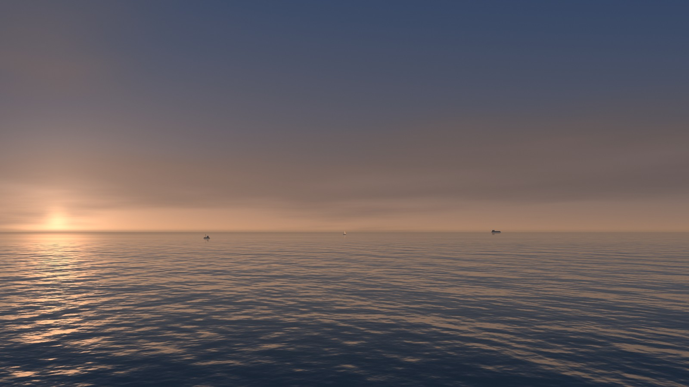
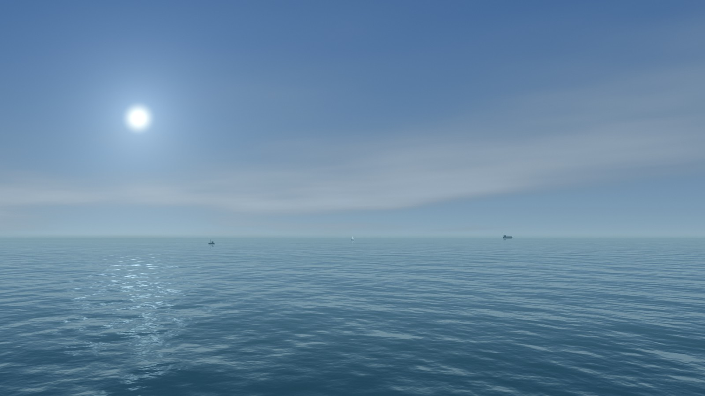
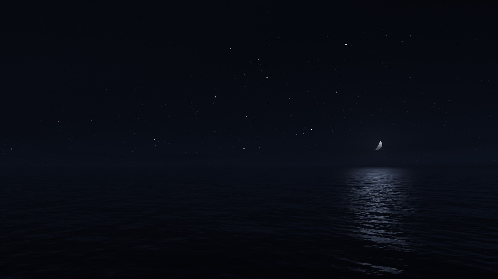
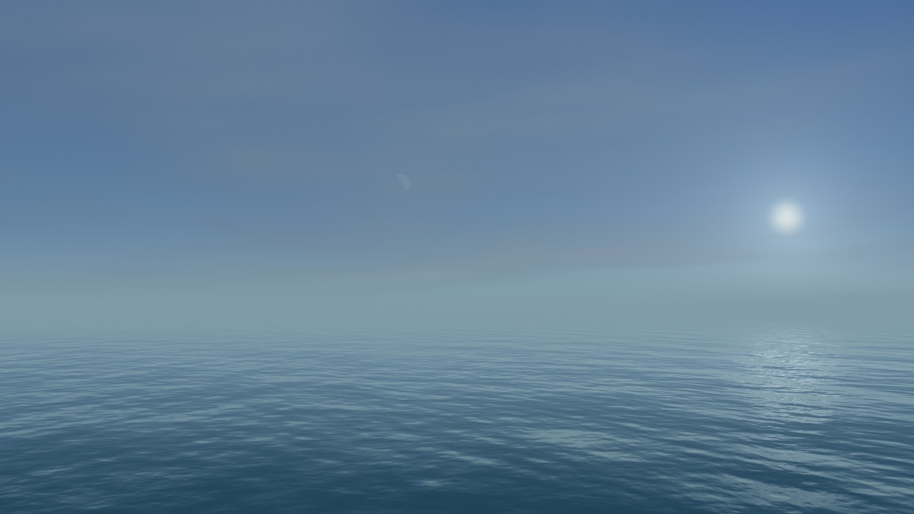
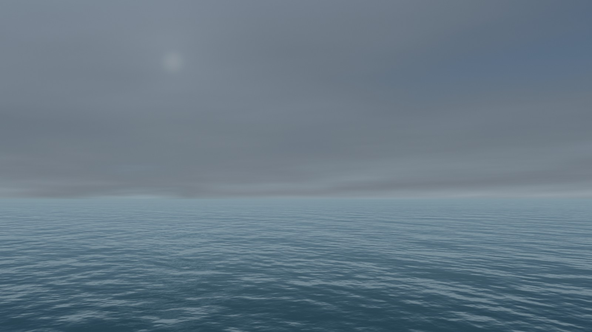
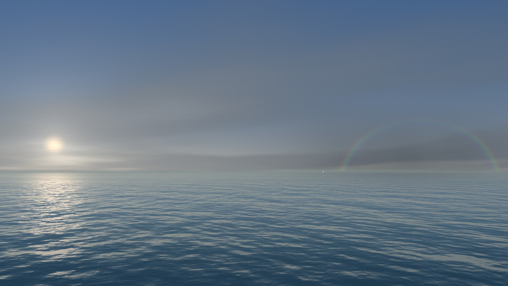
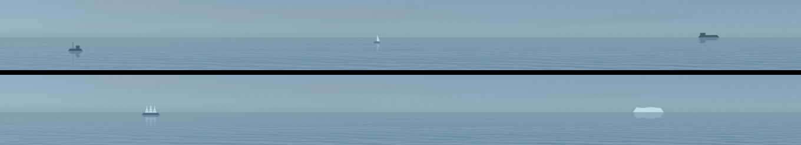

# Slow Horizon

A calm sea for your second screen, so it stops competing with the work on your first.



Slow Horizon covers one display with open water at the real time of day. Whatever was on that display stays where it was, hidden until you quit. Clicks on the scene do nothing, and it never takes keyboard focus, so your typing stays in the app you're working in.

It's a native macOS app with no dependencies, no network access and no accounts.

## What changes, and how slowly

The one design rule is that nothing arrives suddenly. People notice sudden changes at the edge of their vision without choosing to, so everything here happens slowly enough that you only notice later that it has changed.

A day takes a real day. The sun, moon, moon phase and bright stars are calculated for your location and the current time.

| | How it behaves | How often |
|---|---|---|
| Clear sky | Thin high cloud at most | 75% of the time |
| Overcast | A pale, bright grey that builds over two hours or more | 3% |
| Fog | The horizon dissolves | 5% |
| Rain | A distant shower with the sun still out, never on screen | 3% |
| Calm and rough seas | Follow the wind, gradually | 34% and 18% |
| Boats | A freighter, a yacht and a fishing boat, each taking hours to cross, with lights at night | At least one in view 65% of the time |
| Whale | A far-off blow that fades in and out over 40 seconds, in daylight only | About 6 scheduled a day, fewer seen |
| Rainbow | Only when rain and a low sun coincide | About 75 hours a year at Cape Town's latitude |
| Tall ship | Passes about once a week | About 155 hours a year |
| Iceberg | Takes two days to pass | About 415 hours a year |

The figures come from sampling the generator across three simulated years, counting clear as cover below 25%, overcast as above 75%, and fog and rain as above 50% and 30% strength. Weather is generated, not fetched, so it won't match the sky outside your window. It's weighted towards fair days on purpose, because long grey spells aren't restful. It follows the clock, so restarting the app doesn't change it.

Some things are deliberately missing: lightning, shooting stars, leaping dolphins and birds. The first three are sudden or fast, and birds at this distance look like dirt on the screen.

<table>
  <tr>
    <td></td>
    <td></td>
  </tr>
  <tr>
    <td></td>
    <td></td>
  </tr>
</table>

A rainbow with its top fading into cloud:



Boats at full size. Top row: fishing boat, yacht and freighter. Bottom row: tall ship and iceberg.



These images are rendered by the app with the weather and boats set by hand, because waiting for each one would take months.

## Install

You need macOS 14 or later and Xcode. The Command Line Tools may be enough, since the build only uses `swiftc` and `codesign`, but that's untested. It has only been run on Apple silicon.

```bash
git clone https://github.com/Anri-Lombard/slow-horizon.git
```

```bash
cd slow-horizon && ./build.sh
```

This installs `Slow Horizon.app` to `~/Applications`, where Spotlight finds it.

## Use

Open the app to start it, from Spotlight or `~/Applications`. It has no Dock icon; it shows as a small waves icon in the menu bar at the top of the screen. Open it again to quit, or use **End Slow Horizon** in that menu.

It takes the display that doesn't hold the Claude desktop app, because that's what it was built to sit beside. Without Claude open, it takes a display other than your active one. **Move to Next Display** in the menu bar overrides that until you quit. With one display it hides and waits for a second.

**Moving Water** in the menu bar switches between the animated sea and a still picture that keeps following the sky. The water also stops by itself on battery and in Low Power Mode.

### Your location

By default the longitude comes from your time zone, which puts the sun within about an hour of right, and the latitude is 35° north. For an accurate sky, set both (west and south are negative) and restart the app:

```bash
defaults write com.anrilombard.slowhorizon latitude -float 51.5
```

```bash
defaults write com.anrilombard.slowhorizon longitude -float -0.12
```

### Focus mode

macOS has no public API for Focus, so the app runs two Shortcuts if you create them: `Slow Horizon On` when it starts and `Slow Horizon Off` when it quits. In each, add a **Set Focus** action. Without them, the app works the same and leaves Focus alone.

## What it costs

Measured on an M1 Pro driving a 2560×1440 display at 144 Hz, on mains power:

| | Moving water | Still |
|---|---|---|
| App CPU, share of one core | 5 to 7% | 0.4% |
| App memory | 61 MB | 64 MB |
| GPU, whole machine | 16 to 17% | About 0% |
| Window server CPU | 22 to 25% | Close to idle |

The readings come from an otherwise quiet machine, and the GPU and window server rows include putting the picture on screen. Of the GPU figure, drawing the sea itself takes only 0.55 ms per frame, so most of the cost is the system compositing a moving part of the screen. With the screen locked, the app measured 0% CPU and the GPU stayed at 0%.

The sea runs at a whole divisor of the display's refresh rate so that frames stay up for equal time: 36 frames per second at 144 Hz. In a 15-second sample on that display, 93% of frames stayed up for one 28 ms interval and the rest were one refresh off.

An earlier version of this scene ran in a web view at about 39% GPU, 13% of a core and 175 MB.

## How it works

The wave pattern is baked once at launch into a tiling texture, and three scales of it scroll across each other. Each pixel then traces a ray from a camera 18 m above the sea, so wave size follows true perspective. The water colour comes from a Fresnel reflection of the sky.

Sky and sea are separate layers. The sky is redrawn every 3 seconds at full resolution, and only the sea animates, at 75% of screen resolution and at most 2560 pixels wide. Neither draws when the display can't be seen.

- `Shaders.metal`: the wave bake, sky, sea, boats, rain and rainbow
- `Sky.swift`: sun, moon and stars, weather, and the schedule for boats and whales
- `Renderer.swift`: Metal setup and drawing
- `main.swift`: the window, the menu bar item and choosing a display

Shaders compile when the app launches, so building needs no Metal toolchain.

## Credits

The sun and moon positions use the low-precision formulas from Jean Meeus's *Astronomical Algorithms*, as implemented in [SunCalc](https://github.com/mourner/suncalc) by Volodymyr Agafonkin (BSD 2-Clause, reproduced in `LICENSE`).

## License

[MIT](LICENSE)
